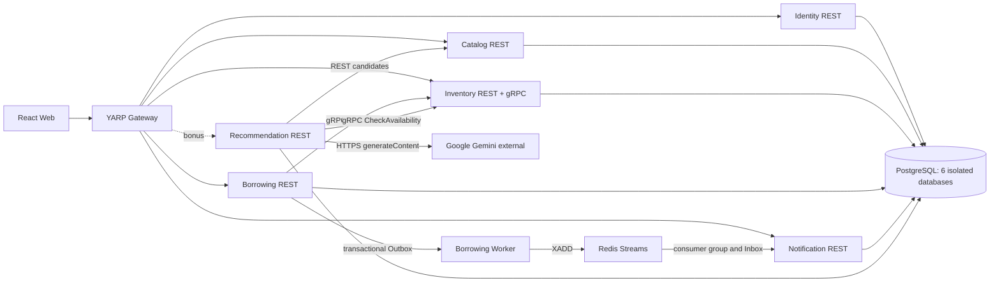

# LabLend AI

LabLend AI là nền tảng mượn/trả thiết bị phòng thí nghiệm cho đại học, phục vụ **STUDENT**, **LAB_STAFF** và **ADMIN**. Sinh viên tra cứu và yêu cầu mượn; staff duyệt, bàn giao, nhận trả và bảo trì; admin quản lý tài khoản và quyền. Đây là PRN232 Final Assignment theo [đề chính thức](docs/requirements/PRN232%20-%20Final%20Assignment.pdf) và [Master Plan V4](PRN232_LabLend_AI_Master_Implementation_Plan_V4.docx).

**Checkpoint hoàn thiện ngày 17/11/2026:** baseline `68933a1` đã merge M3 qua PR #14. Các thay đổi cuối được chia PR-A/PR-B/PR-C, không tự merge main. Xem [nghiệm thu cuối](docs/testing/FINAL_PRODUCT_ACCEPTANCE.md), [handover](docs/team/FINAL_COMPLETION_HANDOVER.md), [audit source](docs/testing/FINAL_SOURCE_AUDIT.md) và [kiến trúc C4/ERD/state machine hiện hành](docs/architecture/FINAL_ARCHITECTURE.md). Báo cáo ghi riêng PASS/FAIL/BLOCKED/NOT RUN/PROVISIONAL và không dùng số test từ checkpoint cũ để chứng nhận code mới.

**Kết quả đã chạy:** 71 backend + 25 frontend PASS, 0 fail/skip; build production và browser desktop/mobile PASS; T20 từ clone mới PASS đủ 13 bước tại `ea868e4`, cùng nội dung runtime với checkpoint `430ff1b`. [JSON, CI và ảnh thực tế](docs/testing/evidence/FINAL_EVIDENCE.md). Nghiệm thu nộp bài vẫn PROVISIONAL do kiểm tra trực quan slide, diễn tập nhóm và phê duyệt OD còn chờ người phụ trách.

Ba luồng chính: Student tìm/xem thiết bị → chọn số lượng → xem lại → tạo phiếu → timeline/thông báo; Staff duyệt/giữ thiết bị → bàn giao → xem lại và nhận trả từng phần; Staff quản lý loại thiết bị/physical assets → bảo trì → lịch sử trạng thái. Admin tìm toàn bộ tài khoản bằng bộ lọc server. Create Loan có khóa chống trùng phía server, token vẫn chỉ ở memory và refresh cookie HttpOnly.

**Contract review:** OD-04/05 và retention vẫn PROVISIONAL; Inventory gRPC v1 còn gap reservation ID/historical condition/time. [Technical M3 review](docs/events/M3_CONTRACT_REVIEW.md) ghi bằng chứng tương thích, không thay chữ ký phê duyệt nhóm. M1 có transactional Outbox, real gRPC lifecycle/recovery và bốn scheduled jobs; nền tảng/evidence lịch sử: [Sprint 2 M1](docs/testing/SPRINT2_M1_ACCEPTANCE.md), [PR8](docs/testing/PR8_INTEGRATION_ACCEPTANCE.md), [Sprint 1](docs/testing/SPRINT1_ACCEPTANCE.md), [Sprint 0](docs/testing/SPRINT0_ACCEPTANCE.md). Các checkpoint cũ không chứng nhận đầy đủ P0 M3 hiện tại.
## Bắt đầu đọc từ đâu

1. [Architecture overview](docs/architecture/ARCHITECTURE_OVERVIEW.md): service boundaries, luồng giao tiếp và trạng thái triển khai.
2. [Team responsibilities](docs/team/TEAM_RESPONSIBILITIES.md): ownership và hướng dẫn riêng cho từng người.
3. [Open decisions](docs/architecture/OPEN_DECISIONS.md): proto/event/security semantics cần review trước khi code.
4. [REST conventions và contracts](docs/api/REST_CONTRACTS.md), [gRPC guide](docs/grpc/INVENTORY_CONTRACT_GUIDE.md), [event guide](docs/events/EVENT_CONTRACT_GUIDE.md).
5. [Requirement traceability](docs/requirements/REQUIREMENTS_TRACEABILITY.md) và [test plan](docs/testing/TEST_PLAN.md).
6. [Sprint 0 handover](docs/team/SPRINT0_HANDOVER.md): file/project đã tạo, phạm vi thực tế và hướng dẫn tiếp quản.

## System architecture



Mỗi service có `Host/Api → Application → Domain`; Infrastructure triển khai repositories/ports và DbContext riêng. Inventory được deploy riêng, proto allocation v1 có sáu RPC; Borrowing dùng service credential, deadline và correlation metadata. Worker quét hạn/operations và publish Outbox qua Redis; Notification dùng consumer group + Inbox dedupe. Một PostgreSQL instance chứa 6 database với 6 login riêng; không FK/SQL join/DbContext xuyên service. Recommendation là bonus opt-in; Gemini disabled mặc định.

## Technology stack

| Thành phần | Công nghệ |
|---|---|
| Backend | .NET 8, ASP.NET Core 8, C# 12 |
| Data | EF Core 8 + Npgsql 8.x, PostgreSQL 16 |
| Gateway | YARP 2.3, JWT Bearer validation, CORS allowlist, rate limit |
| Communication | gRPC HTTP/2; Redis 7.4 Streams + transactional Outbox/Inbox |
| Background | .NET BackgroundService process |
| Frontend | React, TypeScript, Vite, npm lockfile |
| Tests | xUnit; WebApplicationFactory cho platform tests |
| Deploy | Docker Compose local, multi-stage images |
| Bonus | Google Gemini API, backend + UI + history đã triển khai, tắt mặc định |

Backend versions khóa tại `Directory.Packages.props`; SDK tại `global.json`; frontend versions khóa trong `apps/web/package.json` và `package-lock.json`. Không dùng .NET/EF Core 9 hoặc 10. **.NET 8 đã hết hỗ trợ vào 10/11/2026**, chỉ dùng cho coursework local theo quyết định V4; cần nâng cấp trước khi vận hành public lâu dài ([Microsoft policy](https://dotnet.microsoft.com/en-us/platform/support/policy/dotnet-core)). Image tags theo nhánh phiên bản, không phải digest bất biến.

## Installation and Docker deployment

Cần Git, Docker Desktop chạy **Linux containers** và Docker Compose. Để code ngoài Docker, cài **SDK 8.0.423** (hoặc patch cùng feature band mà global.json cho phép), Node **22.12+**, npm và PowerShell. Windows PowerShell 5.1 hoặc PowerShell 7 chạy được các script setup; CI dùng PowerShell 7. Docker Desktop phải đáp ứng điều kiện license miễn phí của người sử dụng.

```powershell
git clone https://github.com/NguyenNhuDai05/lablend-ai.git
cd lablend-ai
# main đã có foundation và tích hợp M1/M3.
./scripts/Initialize-Environment.ps1
docker compose config --quiet
./scripts/Build-Images.ps1
./scripts/Start-Core.ps1  # đợi từng service healthy, phù hợp máy ít RAM
docker compose ps
./scripts/Verify-Sprint0.ps1
./scripts/Verify-Sprint2.ps1  # current Borrowing endpoints/migrations, four job passes and readiness
```

Script setup sinh `.env` với random credentials, **không in secrets và không ghi đè file đã tồn tại**. Không chỉ copy `.env.example` rồi để password rỗng. Compose core chạy mặc định: web, gateway, identity, catalog, inventory, borrowing, notification, worker, postgres, redis. Optional recommendation host sau khi đã build bonus: `./scripts/Start-Core.ps1 -IncludeBonus`; host nhận key server-side từ .env khi chủ động bật AI; xem hướng dẫn Recommendation bên dưới. Observability dashboard là **Planned**, chưa tạo profile giả. Core không phụ thuộc Gemini hoặc Internet khi đã tải image/package.

| URL mặc định | Dùng để làm gì |
|---|---|
| http://localhost:3000 | Frontend khởi đầu, nút kiểm tra Gateway thật |
| http://localhost:5080/health/live | Gateway process health |
| http://localhost:5080/swagger | Gateway OpenAPI UI; xem schema từng service qua platform endpoints |
| http://localhost:5080/platform/catalog/health/ready | Gateway → Catalog → PostgreSQL SELECT 1 |
| http://localhost:5080/platform/inventory/health/ready | Inventory REST readiness |
| http://localhost:5080/platform/notification/health/ready | Notification → PostgreSQL + Redis PING |
| http://localhost:5080/platform/identity/openapi.json | OpenAPI schema của host qua Gateway |

Chỉ web và gateway publish cổng **loopback**; DB/Redis/API/gRPC nằm trong Docker network `backend` internal. Gateway và Recommendation bonus có thêm network `edge` (Recommendation cần outbound HTTPS đến Google). Khi bonus tắt, route Recommendation có thể trả 502; core vẫn chạy, UI hiển thị AI không khả dụng và liên kết về danh mục.

`/health/live` kiểm tra process; REST `/health/ready` kiểm tra dependency kết nối thực, chưa chứng nhận toàn nghiệp vụ. Worker heartbeat yêu cầu PostgreSQL, Redis, Inventory RPC được xác thực và recent passes của cả bốn jobs; dependency lỗi sẽ xóa heartbeat. Nghiệm thu overdue vẫn cần event/notification và logs thực trong acceptance. Standard `grpc.health.v1.Health` không thay ReserveAssets.

## Nghiệm thu bản clone sạch và chuẩn bị demo

```powershell
# PowerShell 7, Git, Docker Linux, Node 22.12+; có Internet để tải dependencies lần đầu.
./scripts/Test-FinalPreflight.ps1
# Dùng commit hoặc nhánh đã review. Nhánh chưa merge phải ghi origin/<branch>.
./scripts/Test-CleanInstall.ps1 -Revision origin/feature/final-c-acceptance
```

T20 clone source vào `.tmp/clean-install`, sinh `.env` mới, dùng project `lablend-t20-<random>`, ports/volumes riêng, build và khởi động tuần tự bằng Start-Core. PostgreSQL health dùng TCP để tránh server tạm trong bootstrap báo ready quá sớm. Harness chạy production web bằng Playwright, REST qua Gateway, PostgreSQL/Redis/gRPC thật, xác nhận state DB theo ownership, ba flow, nhắc hạn thực, reconnect/restart, phân quyền và mobile. Kết quả ở thư mục `*-evidence`: `t20-result.json`, `docker-e2e.json`, `containers.json` và ảnh. PASS chỉ khi mọi stage hoàn tất. Core integration/browser fixture là gate riêng, không thay T20. Nếu Docker chưa hoạt động, T20 dừng BLOCKED trước khi tạo dữ liệu.

Mặc định chỉ dừng container/network do T20 sở hữu khi kết thúc, giữ toàn bộ volumes. `-KeepRunning` giữ fixture để đọc evidence. Không xóa shared database/volumes hoặc reset Docker/WSL. Không chạy integration tests và image build nặng cùng lúc trên máy ít RAM.

Với database mới chưa có admin, có thể bootstrap một lần bằng local override. Nếu đã có admin, dùng tài khoản hiện có; bootstrap không đổi password hay nâng quyền người dùng cũ. Không commit credentials cục bộ. Start-Core, preflight, T20 và demo cần PowerShell 7.

```powershell
$env:LABLEND_DEMO_ADMIN_PASSWORD = Read-Host 'New local admin password (12+ characters)' -MaskInput
New-Item -ItemType Directory -Force .tmp | Out-Null
@'
services:
  identity:
    environment:
      Bootstrap__Enabled: "true"
      Bootstrap__AdminEmail: "admin@demo.test"
      Bootstrap__AdminPassword: "${LABLEND_DEMO_ADMIN_PASSWORD:?local admin password required}"
'@ | Set-Content .tmp/bootstrap-demo.compose.yml
docker compose -f docker-compose.yml -f .tmp/bootstrap-demo.compose.yml up -d --no-build --wait identity
# Tắt bootstrap sau khi admin đầu tiên đã được tạo.
docker compose up -d --no-build --wait identity
```

Dữ liệu diễn tập dùng lại qua API thật:

```powershell
# Admin phải được bootstrap cục bộ trước như hướng dẫn Identity bên dưới.
$env:LABLEND_DEMO_ADMIN_PASSWORD = Read-Host 'Local demo admin password' -MaskInput
$env:LABLEND_DEMO_USER_PASSWORD = Read-Host 'Password for new demo Student/Staff accounts' -MaskInput
./scripts/Initialize-DemoData.ps1 -AdminEmail admin@demo.test
Remove-Item Env:LABLEND_DEMO_ADMIN_PASSWORD,Env:LABLEND_DEMO_USER_PASSWORD
```

Script tạo hoặc tìm tài khoản `prn232-student@demo.test`, `prn232-lab_staff@demo.test`, loại thiết bị `PRN232 Signal Kit` và ba serial `PRN232-DEMO-1..3`. Không đổi password hoặc reset trạng thái tài khoản/thiết bị đã có; khác ownership/quyền thì dừng để người vận hành kiểm tra. Không tự tạo loan/history/event để giả lập demo. Dùng [runbook](docs/demo/FINAL_DEMO_RUNBOOK.md) và [checklist phân chia thuyết trình](docs/demo/FINAL_DEFENSE_CHECKLIST.md).

## Local development

Chạy hạ tầng với cổng loopback cho local SDK:

```powershell
docker compose -f docker-compose.yml -f infrastructure/docker/compose.dev.yml up -d --wait postgres redis
dotnet --info
dotnet tool restore
dotnet restore LabLendAI.sln
dotnet build LabLendAI.sln -c Release
dotnet test LabLendAI.sln -c Release --no-build
```

Mỗi host dùng terminal riêng; ví dụ Member 2:

```powershell
./scripts/Run-LocalHost.ps1 -Service catalog
# Terminal khác:
./scripts/Run-LocalHost.ps1 -Service inventory
# Terminal khác:
./scripts/Run-LocalHost.ps1 -Service gateway
```

Service choices: `gateway`, `identity`, `catalog`, `inventory`, `borrowing`, `notification`, `recommendation`, `worker`. Script nạp env đúng database. Local ports: Gateway 5080; Identity 5101; Catalog 5102; Inventory REST 5103 và gRPC 5181; Borrowing 5104; Notification 5105; Recommendation 5106. Swagger trực tiếp ở `http://localhost:<rest-port>/swagger`.

Nếu chạy Gateway local thì dừng Gateway Docker (`docker compose stop gateway web`) để tránh trùng cổng. Gateway local trỏ tới host local; Gateway Docker trỏ tới DNS container, không tự trộn hai chế độ. Script local dùng cổng REST cố định nêu trên; chỉ public Gateway/Web và infrastructure dev ports tùy chỉnh bằng `.env`.

Frontend:

```powershell
cd apps/web
Copy-Item .env.example .env.local
npm ci
npm run dev
# Kiểm tra bản build:
npm run build
```

Mở http://localhost:5173. Frontend đã có routing, register/login/session restore, notifications và staff UI của M3; Staff Catalog/Inventory dùng API thật của M2 và JWT Identity trong memory. `/staff` chuyển vào Catalog, LAB_STAFF/ADMIN có quyền; Student bị chặn. `VITE_API_BASE_URL` là URL public, mặc định trong env mẫu `http://localhost:5080`. Docker frontend dùng relative requests qua nginx → Gateway. Mọi `VITE_*` đều có thể lộ ra browser; tuyệt đối không đặt Gemini key/JWT secret tại đây.

## Database and environment variables

| Variable | Ý nghĩa |
|---|---|
| `POSTGRES_ADMIN_PASSWORD` | Chỉ container PostgreSQL/init dùng |
| `IDENTITY_DB_PASSWORD` … `RECOMMENDATION_DB_PASSWORD` | Mỗi service chỉ nhận password DB của mình |
| `REDIS_PASSWORD` | Redis auth và các host cần Redis |
| `JWT_SIGNING_KEY` | Random tối thiểu 32 byte; Identity phát JWT và Gateway/REST validate cùng issuer/audience/key |
| `INVENTORY_SERVICE_TOKEN` | Bearer service credential cho mọi Inventory business RPC; Borrowing API/worker dùng cùng credential nội bộ, không dùng user JWT |
| `GEMINI_ENABLED`, `GEMINI_API_KEY`, `GEMINI_MODEL` | Bonus Recommendation; server-side, disabled mặc định; Free tier project do người dùng tự cấu hình |
| `GATEWAY_PORT`, `WEB_PORT` | Publish loopback, mặc định 5080/3000 |
| `POSTGRES_DEV_PORT`, `REDIS_DEV_PORT` | Chỉ file Compose dev dùng, mặc định 55432/56379 |

Database/users, migration commands, init/reapply: [DATABASE_CONVENTIONS](docs/architecture/DATABASE_CONVENTIONS.md). Identity/Borrowing/Notification Development startup áp dụng migrations thật; production mặc định tắt auto-migrate. Catalog/Inventory áp dụng migrations + seed idempotent của M2 khi host khởi động; Recommendation có migrations session/items và atomic daily usage, áp dụng theo Database:AutoMigrate (Development/Compose bật). `docker compose down` giữ volumes. **Không chạy `down -v` nếu chưa chủ động chấp nhận mất dữ liệu development.** Setup/init không tự xóa volume.

## Sprint 1 Identity and Borrowing

Branch `feature/m1-identity-jwt` được tạo từ foundation 3431927, sau đó tích hợp M3 và đã push/merge vào main tại `8dac358`. [Identity contract](docs/api/IDENTITY_API_CONTRACT.md) và [Borrowing contract](docs/api/BORROWING_API_CONTRACT.md) là hợp đồng hiện hành; [báo cáo tích hợp](docs/team/M1_M3_INTEGRATION.md) bổ sung trạng thái sau checkpoint [handover Sprint 1](docs/team/SPRINT1_HANDOVER.md).

Register/login qua Gateway; mọi POST `/api/auth/*` cần Origin localhost:5173 hoặc localhost:3000 và `X-LabLend-CSRF: 1`. React dùng credentials include, access JWT 10 phút trong memory và refresh HttpOnly cookie 7 ngày; serialize refresh. Local HTTP dùng Development cookie Secure=false, môi trường HTTPS phải bật Secure. Logout thu hồi refresh family; JWT ở service khác vẫn có thể dùng tới expiry + 30 giây skew. Không lưu refresh vào localStorage.

Admin đầu tiên: chỉ Development, truyền `Bootstrap__Enabled=true`, `Bootstrap__AdminEmail`, `Bootstrap__AdminPassword` qua môi trường local rồi khởi động Identity; không có mật khẩu mặc định hay endpoint tạo ADMIN public. Seed không reset/promote user tồn tại. Compose có thể nhận bootstrap tạm thời qua một local override không commit; không đặt credentials vào source. Tắt bootstrap sau lần đầu.

Borrowing hỗ trợ tạo/list/detail/cancel/reject và Staff approve/handover/partial returns qua Inventory gRPC thật. POST /api/loans nhận Idempotency-Key tùy chọn, bảo vệ gửi trùng cùng draft theo StudentId; frontend gửi sau bước xem lại. Mọi create thành công gồm loan/items/history/outbox trong cùng transaction. Due date >now và <=30 ngày; 1–20 items, mỗi item 1 unit. Runtime gọi Catalog thật để xác thực id/isActive, không có fallback cho ID giả. M2 cung cấp GET /api/equipment-types/{id} với id/isActive. `MemberIntegrationTests` khởi chạy Catalog thật, xác nhận type hợp lệ, missing và inactive; các unit/dependency tests cũ vẫn giữ double được đánh dấu rõ.

Chạy tất cả tests với PostgreSQL disposable, tách khỏi .env/volumes nhóm (Docker Desktop phải hoạt động):

```powershell
$env:LABLEND_POSTGRES_TESTS = '1'
dotnet restore LabLendAI.sln
dotnet build LabLendAI.sln -c Release
dotnet test LabLendAI.sln -c Release --no-build --no-restore
```

Không đặt flag thì PostgreSQL suites báo SKIPPED; đó không phải PASS. Fixture tạo project Compose riêng, password tạm thời, năm DB/roles identity/borrowing/catalog/inventory/notification và Redis với stable loopback port riêng, rồi chỉ dọn tài nguyên của fixture; không nhận connection string thật của nhóm. Sprint2 tests chạy real JWT/REST/Inventory HTTP/2/Redis/Notification và worker processes, có failure injection được ghi rõ. YARP regression cũ dùng Catalog double có nhãn. M2 Catalog/Inventory tests dùng Testcontainers PostgreSQL và gRPC Kestrel. CI bật flag; kết quả exact commit và links trong acceptance.

Runtime verification sau khi Compose đã chạy: `./scripts/Verify-Sprint1.ps1` (thêm `-IncludeBonus` khi Recommendation host đang chạy). Script chỉ đọc readiness/OpenAPI/authorization/migration metadata và kiểm tra isolation; không tạo test user/loan trong database nhóm. Checkpoint trước PR #8 (M1/M3): 38 tests .NET và 7 tests frontend PASS, Release build 0 warnings/errors, 11 containers healthy; Identity/Borrowing/Notification migrations đã áp dụng. [Checkpoint M1 và giới hạn Catalog](docs/testing/SPRINT1_ACCEPTANCE.md), [kết quả tích hợp](docs/team/M1_M3_INTEGRATION.md).

## Team responsibilities

| Member | Ownership chính | Sprint tiếp theo |
|---|---|---|
| 1 – Tech Lead/Core | Gateway, shared technical defaults, Docker, Identity, Borrowing, Worker/Outbox | JWT/Identity thật, Borrowing use cases, contracts integration |
| 2 – Catalog/Inventory | Catalog, Inventory REST + gRPC, catalog_db/inventory_db, Staff UI | CRUD/search, proto review, atomic reservation/idempotency/concurrency |
| 3 – Frontend/Notification/AI | apps/web shell, Notification consumer, Recommendation, notification_db/recommendation_db, Admin/AI UI | UI routing/auth, notification/inbox contract; Gemini chỉ sau core |

Mục tiêu phân bổ tổng công sức 34%/33%/33% là kế hoạch; không phải số đo đã thực hiện. Member 2 chỉnh Staff feature trong frontend sau khi Member 3 thống nhất routing/layout. Không tự sửa contract hoặc database của service khác. Chi tiết bàn giao: [TEAM_RESPONSIBILITIES](docs/team/TEAM_RESPONSIBILITIES.md).

## Branch and PR workflow

`main` giữ bản được review. Làm việc trên `feature/*`, `fix/*`, `docs/*`; bootstrap trên `chore/sprint0-foundation`.

```powershell
git fetch origin
git switch main
git pull --ff-only origin main
git switch -c feature/m2-catalog-crud
# Code, kiểm tra, commit các file liên quan (kiểm tra git diff --cached).
git push -u origin feature/m2-catalog-crud
```

Trước khi main có Sprint 0, checkout branch bootstrap rồi tạo feature branch từ đó; sau khi bootstrap merge, đồng bộ base với main theo thỏa thuận nhóm. Tạo issue có owner/dependencies/acceptance; dùng PR template; chủ module và consumer review thay đổi contract trước merge. Không force-push, không commit `.env`, không tự merge main. CI chạy restore/build/platform tests/npm ci/build/Compose config; không gọi Gemini, không bật billing. Module ownership được ghi bằng tài liệu vì chưa có GitHub handle của Member 2/3; chưa cấu hình CODEOWNERS giả.

## Troubleshooting

- Docker pipe/daemon unavailable: mở Docker Desktop hoặc `docker desktop start`, chọn Linux containers; kiểm tra `docker info`.
- Không tìm thấy SDK: cài SDK tương ứng `global.json`; `dotnet --version` phải thuộc 8.0.4xx. Không sửa sang SDK 9/10 để né lỗi.
- Missing JWT/password: chạy script setup; file `.env` không tự nạp vào `dotnet run`, dùng script local.
- Database password sai sau thay `.env`: init chỉ tự chạy khi volume mới. Khôi phục `.env` cũ hoặc reapply init có chủ đích theo database guide; không xóa volume để né lỗi.
- Gateway 502: kiểm tra host đã chạy đúng DNS/port; Recommendation cần bonus profile. `/health/live` của Gateway không bảo đảm upstream ready.
- Readiness 503: xem `docker compose ps` và log service; readiness không biến dependency lỗi thành HTTP 200.
- Build lần đầu chậm: tải image/NuGet/npm cần Internet. `Build-Images.ps1` build tuần tự và dùng chung restore cache, phù hợp Docker VM ít RAM; lệnh up --build sau đó dùng cache.
- Sau clone Windows, shell init cần LF: `.gitattributes` đã ép `*.sh` về LF.

Chẩn đoán startup 139: [bằng chứng PostgreSQL bootstrap/health race và correction](docs/testing/FINAL_DOCKER_DIAGNOSIS.md). Không suy luận OOM từ exit code hoặc xóa volumes để xử lý.

Không có hosting, domain, managed DB/Redis hoặc API trả phí. Gemini đã được tích hợp trong backend Recommendation; chỉ bật với Free Tier đủ điều kiện và không bật billing. Live provider verification được ghi riêng, không suy từ mock tests. Trạng thái **Implemented / Scaffolded / Planned / Blocked** phải được cập nhật theo bằng chứng thật, không theo số lượng project.

## Google Gemini equipment recommendation

Student có thể vào `/recommendations`, nhập mục tiêu, xem gợi ý từ Catalog thật với Inventory read-only, chọn nhiều thiết bị rồi chuyển sang form mượn để chọn hạn trả và xác nhận. History riêng từng user tại `/recommendations/history`. Gemini không giữ kho hoặc duyệt phiếu.

Xem [API contract](docs/api/RECOMMENDATION_API_CONTRACT.md), [cấu hình Free Tier và demo Windows](docs/demo/RECOMMENDATION_DEMO.md), [báo cáo triển khai và kết quả kiểm thử](docs/testing/RECOMMENDATION_IMPLEMENTATION.md). Mặc định AI tắt; không có key thì trả AI_UNAVAILABLE, core vẫn chạy. Không gửi key qua chat, không đặt vào VITE_* hoặc commit .env.

[Nghiệm thu live ngày 18/11/2026](docs/testing/GEMINI_LIVE_ACCEPTANCE_REPORT.md) ghi riêng cấu hình runtime, một lượt Google HTTP thực tế, kết quả API/UI, fixture Borrowing và automated tests. Không coi metadata/model lookup hoặc mock tests là bằng chứng Gemini inference thành công.
