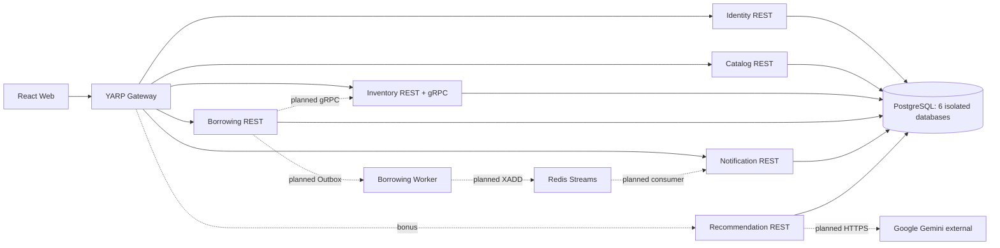

# LabLend AI

LabLend AI là nền tảng mượn/trả thiết bị phòng thí nghiệm cho đại học, phục vụ **STUDENT**, **LAB_STAFF** và **ADMIN**. Sinh viên tra cứu và yêu cầu mượn; staff duyệt, bàn giao, nhận trả và bảo trì; admin quản lý tài khoản và quyền. Đây là PRN232 Final Assignment theo [đề chính thức](docs/requirements/PRN232%20-%20Final%20Assignment.pdf) và [Master Plan V4](PRN232_LabLend_AI_Master_Implementation_Plan_V4.docx).

**Trạng thái: Sprint 1 Member 1.** Identity/JWT/refresh/profile/admin và Borrowing Core đã có code, migrations, automated tests. Tạo loan với Catalog thật còn BLOCKED vì Catalog backend trong main vẫn là skeleton. Approval/gRPC allocation, luồng Redis đầy đủ, worker overdue và UI loan hoàn chỉnh vẫn Planned. Bằng chứng: [SPRINT1_ACCEPTANCE](docs/testing/SPRINT1_ACCEPTANCE.md); nền tảng trước đó: [SPRINT0_ACCEPTANCE](docs/testing/SPRINT0_ACCEPTANCE.md).

**Tích hợp M1/M3 ngày 16/11/2026:** frontend routing/auth, staff UI và Notification của M3 đã được ghép với Identity/Borrowing. Auth client đã khớp cookie/CSRF, roles[] và confirmPassword; access token ở memory, refresh được serialize. [Báo cáo tích hợp và kiểm thử](docs/team/M1_M3_INTEGRATION.md). Catalog/Inventory backend ở nhánh M2 chưa thuộc lần merge này; consumer Redis của M3 vẫn dùng contract proposal, chưa có Borrowing producer.

## Bắt đầu đọc từ đâu

1. [Architecture overview](docs/architecture/ARCHITECTURE_OVERVIEW.md): service boundaries, luồng giao tiếp và trạng thái triển khai.
2. [Team responsibilities](docs/team/TEAM_RESPONSIBILITIES.md): ownership và hướng dẫn riêng cho từng người.
3. [Open decisions](docs/architecture/OPEN_DECISIONS.md): proto/event/security semantics cần review trước khi code.
4. [REST conventions và contracts](docs/api/REST_CONTRACTS.md), [gRPC guide](docs/grpc/INVENTORY_CONTRACT_GUIDE.md), [event guide](docs/events/EVENT_CONTRACT_GUIDE.md).
5. [Requirement traceability](docs/requirements/REQUIREMENTS_TRACEABILITY.md) và [test plan](docs/testing/TEST_PLAN.md).
6. [Sprint 0 handover](docs/team/SPRINT0_HANDOVER.md): file/project đã tạo, phạm vi thực tế và hướng dẫn tiếp quản.

## System architecture



Mỗi service có `Host/Api → Application → Domain`; Infrastructure triển khai repository interfaces và DbContext riêng. Các mũi tên nghiệp vụ nét đứt là **Planned**. Inventory được deploy riêng với Borrowing; gRPC health HTTP/2 được chuẩn bị riêng, proto nghiệp vụ chưa chốt. Một PostgreSQL instance chứa 6 database với 6 login riêng; không FK/SQL join/DbContext xuyên service.

## Technology stack

| Thành phần | Công nghệ |
|---|---|
| Backend | .NET 8, ASP.NET Core 8, C# 12 |
| Data | EF Core 8 + Npgsql 8.x, PostgreSQL 16 |
| Gateway | YARP 2.3, JWT Bearer validation, CORS allowlist, rate limit |
| Communication | gRPC HTTP/2; Redis 7.4 Streams dự kiến cho events |
| Background | .NET BackgroundService process |
| Frontend | React, TypeScript, Vite, npm lockfile |
| Tests | xUnit; WebApplicationFactory cho platform tests |
| Deploy | Docker Compose local, multi-stage images |
| Bonus | Google Gemini API, chưa tích hợp, tắt mặc định |

Backend versions khóa tại `Directory.Packages.props`; SDK tại `global.json`; frontend versions khóa trong `apps/web/package.json` và `package-lock.json`. Không dùng .NET/EF Core 9 hoặc 10. **.NET 8 đã hết hỗ trợ vào 10/11/2026**, chỉ dùng cho coursework local theo quyết định V4; cần nâng cấp trước khi vận hành public lâu dài ([Microsoft policy](https://dotnet.microsoft.com/en-us/platform/support/policy/dotnet-core)). Image tags theo nhánh phiên bản, không phải digest bất biến.

## Installation and Docker deployment

Cần Git, Docker Desktop chạy **Linux containers** và Docker Compose. Để code ngoài Docker, cài **SDK 8.0.423** (hoặc patch cùng feature band mà global.json cho phép), Node **22.12+**, npm và PowerShell. Windows PowerShell 5.1 hoặc PowerShell 7 chạy được các script setup; CI dùng PowerShell 7. Docker Desktop phải đáp ứng điều kiện license miễn phí của người sử dụng.

```powershell
git clone https://github.com/NguyenNhuDai05/lablend-ai.git
cd lablend-ai
# Nếu Sprint 0 chưa merge main:
git switch chore/sprint0-foundation
./scripts/Initialize-Environment.ps1
docker compose config --quiet
./scripts/Build-Images.ps1
docker compose up -d --build --wait --wait-timeout 180
docker compose ps
./scripts/Verify-Sprint0.ps1
```

Script setup sinh `.env` với random credentials, **không in secrets và không ghi đè file đã tồn tại**. Không chỉ copy `.env.example` rồi để password rỗng. Compose core chạy mặc định: web, gateway, identity, catalog, inventory, borrowing, notification, worker, postgres, redis. Optional recommendation host: `docker compose --profile bonus up -d --build --wait`; host này chưa tích hợp AI và không nhận API key trong Sprint 0. Observability dashboard là **Planned**, chưa tạo profile giả. Core không phụ thuộc Gemini hoặc Internet khi đã tải image/package.

| URL mặc định | Dùng để làm gì |
|---|---|
| http://localhost:3000 | Frontend khởi đầu, nút kiểm tra Gateway thật |
| http://localhost:5080/health/live | Gateway process health |
| http://localhost:5080/swagger | Gateway OpenAPI UI; xem schema từng service qua platform endpoints |
| http://localhost:5080/platform/catalog/health/ready | Gateway → Catalog → PostgreSQL SELECT 1 |
| http://localhost:5080/platform/inventory/health/ready | Inventory REST readiness |
| http://localhost:5080/platform/notification/health/ready | Notification → PostgreSQL + Redis PING |
| http://localhost:5080/platform/identity/openapi.json | OpenAPI schema của host qua Gateway |

Chỉ web và gateway publish cổng **loopback**; DB/Redis/API/gRPC nằm trong Docker network `backend` internal. Gateway có thêm network `edge`. Khi bonus tắt, route Recommendation có thể trả 502; core vẫn chạy, không coi đây là AI endpoint đã hoàn thiện.

`/health/live` kiểm tra process; `/health/ready` kiểm tra dependency kết nối thực, **chưa kiểm tra business schema/migrations**. Worker health là heartbeat sau PostgreSQL/Redis check, không phải chứng cứ overdue job. Standard `grpc.health.v1.Health` kiểm tra transport và dependency, không phải ReserveAssets.

## Local development

Chạy hạ tầng với cổng loopback cho local SDK:

```powershell
docker compose -f docker-compose.yml -f infrastructure/docker/compose.dev.yml up -d --wait postgres redis
dotnet --info
dotnet tool restore
dotnet restore LabLendAI.sln
dotnet build LabLendAI.sln -c Release
dotnet test LabLendAI.sln -c Release --no-build
```

Mỗi host dùng terminal riêng; ví dụ Member 2:

```powershell
./scripts/Run-LocalHost.ps1 -Service catalog
# Terminal khác:
./scripts/Run-LocalHost.ps1 -Service inventory
# Terminal khác:
./scripts/Run-LocalHost.ps1 -Service gateway
```

Service choices: `gateway`, `identity`, `catalog`, `inventory`, `borrowing`, `notification`, `recommendation`, `worker`. Script nạp env đúng database. Local ports: Gateway 5080; Identity 5101; Catalog 5102; Inventory REST 5103 và gRPC 5181; Borrowing 5104; Notification 5105; Recommendation 5106. Swagger trực tiếp ở `http://localhost:<rest-port>/swagger`.

Nếu chạy Gateway local thì dừng Gateway Docker (`docker compose stop gateway web`) để tránh trùng cổng. Gateway local trỏ tới host local; Gateway Docker trỏ tới DNS container, không tự trộn hai chế độ. Script local dùng cổng REST cố định nêu trên; chỉ public Gateway/Web và infrastructure dev ports tùy chỉnh bằng `.env`.

Frontend:

```powershell
cd apps/web
Copy-Item .env.example .env.local
npm ci
npm run dev
# Kiểm tra bản build:
npm run build
```

Mở http://localhost:5173. Member 3 tiếp quản frontend shell, routing/auth/pages/components; chưa có UI nghiệp vụ. `VITE_API_BASE_URL` là URL public, mặc định trong env mẫu `http://localhost:5080`. Docker frontend dùng relative requests qua nginx → Gateway. Mọi `VITE_*` đều có thể lộ ra browser; tuyệt đối không đặt Gemini key/JWT secret tại đây.

## Database and environment variables

| Variable | Ý nghĩa |
|---|---|
| `POSTGRES_ADMIN_PASSWORD` | Chỉ container PostgreSQL/init dùng |
| `IDENTITY_DB_PASSWORD` … `RECOMMENDATION_DB_PASSWORD` | Mỗi service chỉ nhận password DB của mình |
| `REDIS_PASSWORD` | Redis auth và các host cần Redis |
| `JWT_SIGNING_KEY` | Random tối thiểu 32 byte; Identity phát JWT và Gateway/REST validate cùng issuer/audience/key |
| `INVENTORY_SERVICE_TOKEN` | Reserved cho gRPC service authorization Sprint sau, chưa áp vào business RPC |
| `GEMINI_ENABLED`, `GEMINI_API_KEY`, `GEMINI_MODEL` | Dành cho bonus tương lai; hiện disabled, không truyền key vào container |
| `GATEWAY_PORT`, `WEB_PORT` | Publish loopback, mặc định 5080/3000 |
| `POSTGRES_DEV_PORT`, `REDIS_DEV_PORT` | Chỉ file Compose dev dùng, mặc định 55432/56379 |

Database/users, migration commands, init/reapply: [DATABASE_CONVENTIONS](docs/architecture/DATABASE_CONVENTIONS.md). Identity/Borrowing Development startup áp dụng migrations thật; production mặc định tắt auto-migrate. Các service khác chưa có model/migrations nghiệp vụ. `docker compose down` giữ volumes. **Không chạy `down -v` nếu chưa chủ động chấp nhận mất dữ liệu development.** Setup/init không tự xóa volume.

## Sprint 1 Identity and Borrowing

Branch `feature/m1-identity-jwt` được tạo từ foundation 3431927 vì main local vẫn chưa có Sprint 0. Chưa push/merge. [Identity contract](docs/api/IDENTITY_API_CONTRACT.md) và [Borrowing contract](docs/api/BORROWING_API_CONTRACT.md) là tài liệu tích hợp hiện hành; [handover](docs/team/SPRINT1_HANDOVER.md) ghi rõ ranh giới M2/M3.

Register/login qua Gateway; mọi POST `/api/auth/*` cần Origin localhost:5173 hoặc localhost:3000 và `X-LabLend-CSRF: 1`. React dùng credentials include, access JWT 10 phút trong memory và refresh HttpOnly cookie 7 ngày; serialize refresh. Local HTTP dùng Development cookie Secure=false, môi trường HTTPS phải bật Secure. Logout thu hồi refresh family; JWT ở service khác vẫn có thể dùng tới expiry + 30 giây skew. Không lưu refresh vào localStorage.

Admin đầu tiên: chỉ Development, truyền `Bootstrap__Enabled=true`, `Bootstrap__AdminEmail`, `Bootstrap__AdminPassword` qua môi trường local rồi khởi động Identity; không có mật khẩu mặc định hay endpoint tạo ADMIN public. Seed không reset/promote user tồn tại. Compose có thể nhận bootstrap tạm thời qua một local override không commit; không đặt credentials vào source. Tắt bootstrap sau lần đầu.

Borrowing chỉ hỗ trợ POST /api/loans, GET /api/loans/my, GET /api/loans/{id}, Staff/Admin GET /api/loans, POST /{id}/cancel và /reject. Due date >now và <=30 ngày; 1–20 items, mỗi item 1 unit. Runtime gọi Catalog thật để xác thực id/isActive, không có fallback cho ID giả. M2 cần cung cấp GET /api/equipment-types/{id}; tests dùng Catalog double có đánh dấu rõ, không thay chứng cứ Catalog thật.

Chạy tất cả tests với PostgreSQL disposable, tách khỏi .env/volumes nhóm (Docker Desktop phải hoạt động):

```powershell
$env:LABLEND_POSTGRES_TESTS = '1'
dotnet restore LabLendAI.sln
dotnet build LabLendAI.sln -c Release
dotnet test LabLendAI.sln -c Release --no-build --no-restore
```

Không đặt flag thì PostgreSQL suites báo SKIPPED; đó không phải bằng chứng PASS. Fixture tự tạo project Compose test tên ngẫu nhiên, password tạm thời, identity_db/borrowing_db và DB roles riêng, rồi xóa đúng container test; không nhận connection string thật của nhóm. YARP integration chạy Identity/Borrowing Kestrel thật + Catalog HTTP test double. Hosted CI bật flag; chưa tuyên bố hosted run mới đã PASS khi chưa push.

Runtime verification sau khi Compose đã chạy: `./scripts/Verify-Sprint1.ps1` (thêm `-IncludeBonus` khi Recommendation host đang chạy). Script chỉ đọc readiness/OpenAPI/authorization/migration metadata và kiểm tra isolation; không tạo test user/loan trong database nhóm. Kết quả phiên này: 30 automated tests PASS, Release build 0 warnings/errors, 11 containers healthy; hai migration thật đã áp dụng. [Evidence và giới hạn Catalog](docs/testing/SPRINT1_ACCEPTANCE.md).

## Team responsibilities

| Member | Ownership chính | Sprint tiếp theo |
|---|---|---|
| 1 – Tech Lead/Core | Gateway, shared technical defaults, Docker, Identity, Borrowing, Worker/Outbox | JWT/Identity thật, Borrowing use cases, contracts integration |
| 2 – Catalog/Inventory | Catalog, Inventory REST + gRPC, catalog_db/inventory_db, Staff UI | CRUD/search, proto review, atomic reservation/idempotency/concurrency |
| 3 – Frontend/Notification/AI | apps/web shell, Notification consumer, Recommendation, notification_db/recommendation_db, Admin/AI UI | UI routing/auth, notification/inbox contract; Gemini chỉ sau core |

Mục tiêu phân bổ tổng công sức 34%/33%/33% là kế hoạch; không phải số đo đã thực hiện. Member 2 chỉnh Staff feature trong frontend sau khi Member 3 thống nhất routing/layout. Không tự sửa contract hoặc database của service khác. Chi tiết bàn giao: [TEAM_RESPONSIBILITIES](docs/team/TEAM_RESPONSIBILITIES.md).

## Branch and PR workflow

`main` giữ bản được review. Làm việc trên `feature/*`, `fix/*`, `docs/*`; bootstrap trên `chore/sprint0-foundation`.

```powershell
git fetch origin
git switch main
git pull --ff-only origin main
git switch -c feature/m2-catalog-crud
# Code, kiểm tra, commit các file liên quan (kiểm tra git diff --cached).
git push -u origin feature/m2-catalog-crud
```

Trước khi main có Sprint 0, checkout branch bootstrap rồi tạo feature branch từ đó; sau khi bootstrap merge, đồng bộ base với main theo thỏa thuận nhóm. Tạo issue có owner/dependencies/acceptance; dùng PR template; chủ module và consumer review thay đổi contract trước merge. Không force-push, không commit `.env`, không tự merge main. CI chạy restore/build/platform tests/npm ci/build/Compose config; không gọi Gemini, không bật billing. Module ownership được ghi bằng tài liệu vì chưa có GitHub handle của Member 2/3; chưa cấu hình CODEOWNERS giả.

## Troubleshooting

- Docker pipe/daemon unavailable: mở Docker Desktop hoặc `docker desktop start`, chọn Linux containers; kiểm tra `docker info`.
- Không tìm thấy SDK: cài SDK tương ứng `global.json`; `dotnet --version` phải thuộc 8.0.4xx. Không sửa sang SDK 9/10 để né lỗi.
- Missing JWT/password: chạy script setup; file `.env` không tự nạp vào `dotnet run`, dùng script local.
- Database password sai sau thay `.env`: init chỉ tự chạy khi volume mới. Khôi phục `.env` cũ hoặc reapply init có chủ đích theo database guide; không xóa volume để né lỗi.
- Gateway 502: kiểm tra host đã chạy đúng DNS/port; Recommendation cần bonus profile. `/health/live` của Gateway không bảo đảm upstream ready.
- Readiness 503: xem `docker compose ps` và log service; readiness không biến dependency lỗi thành HTTP 200.
- Build lần đầu chậm: tải image/NuGet/npm cần Internet. `Build-Images.ps1` build tuần tự và dùng chung restore cache, phù hợp Docker VM ít RAM; lệnh up --build sau đó dùng cache.
- Sau clone Windows, shell init cần LF: `.gitattributes` đã ép `*.sh` về LF.

Không có hosting, domain, managed DB/Redis hoặc API trả phí. Gemini chưa được tích hợp; lúc triển khai bonus chỉ dùng Free Tier đủ điều kiện và không bật billing. Trạng thái **Implemented / Scaffolded / Planned / Blocked** phải được cập nhật theo bằng chứng thật, không theo số lượng project.
