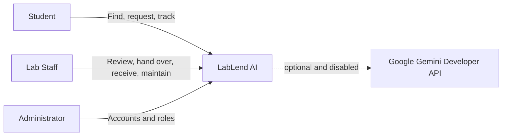
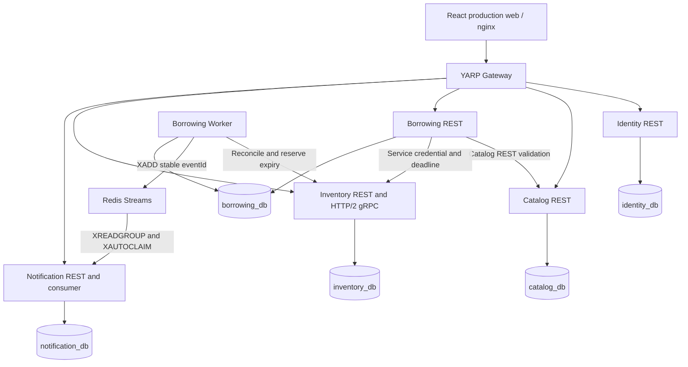
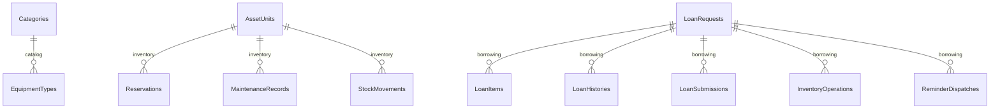
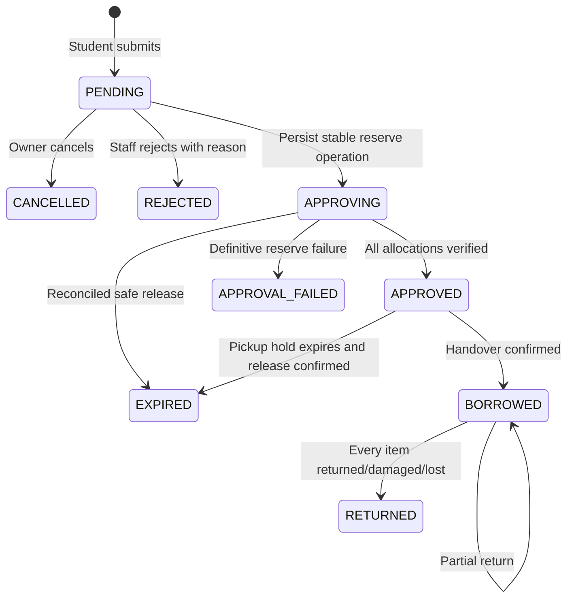
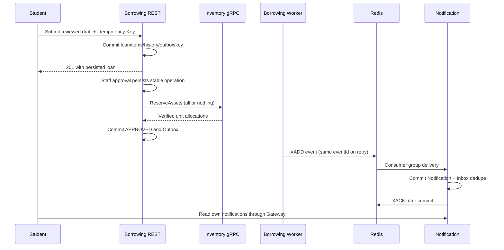

# Final architecture checkpoint

Implemented core: React, YARP, five business REST hosts, independently deployed Inventory gRPC, Borrowing Worker, Redis Streams and PostgreSQL. Recommendation remains an optional skeleton with Gemini disabled. Every production UI mutation uses an authorized API. A browser does not allocate physical assets or write service databases.

## C4 context

## C4 containers

API/controller calls Application services and ports. Infrastructure implements repositories, EF contexts and network adapters. Only API/gateway/web ports intended for local access are exposed. Core service traffic stays in the Compose backend network. Worker belongs to Borrowing and may use its database; another service may not.

## Database ownership and ERD

| Database / login | Owned persisted data |
|---|---|
| identity_db / identity_user | Identity users/roles, refresh-token hashes, audit events |
| catalog_db / catalog_user | Categories, EquipmentTypes |
| inventory_db / inventory_user | AssetUnits, Reservations, ReserveOperations, MaintenanceRecords, StockMovements |
| borrowing_db / borrowing_user | LoanRequests, LoanItems, LoanHistories, LoanSubmissions, InventoryOperations, OutboxMessages, ReminderDispatches |
| notification_db / notification_user | notifications, inbox_messages |
| recommendation_db / recommendation_user | Reserved optional context; no implemented AI history migration |

All lines below are local foreign keys. EquipmentTypeId, StudentId and cross-service loan/asset IDs elsewhere are logical references with no cross-database FK or SQL join.

Outbox AggregateId/EventId and Inbox EventId connect distributed effects by logical IDs. A local Borrowing SaveChanges captures history and outbox in the same transaction. Notification commits its inbox and notification before acknowledgment. No distributed transaction or exactly-once transport is claimed.

## Loan state machine

OVERDUE is derived from DueAt and outstanding borrowed items. An uncertain RPC does not imply approval, handover or return success. Persisted operations block conflicting commands until reconciliation; UI shows the actual backend status and a correlation ID on errors. An APPROVING history entry is a real internal transition, displayed as work in progress.

## Interactions and recovery

Lost replies are reconciled using GetOperationStatus and immutable command intent. v1 has no reservation ID or historical return time/condition in its response. Borrowing preserves its own return intent and only supports the documented single-writer workflow. It never interprets current AssetUnit status as historical return evidence. Inventory owner review remains PR #15; no proto modification is included.

## Delivery contract and retention

Stream `lablend.events.v1`, field `event`, version 1, group `notification-consumers`; seven event types are in the schema and executable producer/consumer tests. XAUTOCLAIM reclaims idle pending entries. Inbox EventId deduplicates notification effects. Repeated non-Redis failures park after the configured attempt limit; Redis failures remain pending.

OD-04/05, retention/archive horizon, replay and parking policy remain **PENDING HUMAN REVIEW**. No stream trimming, inbox deletion, outbox dropping, group resetting or fabricated owner signoff was introduced. The tradeoff is unbounded storage until an approved retention policy exists. See [event contract](../events/EVENT_CONTRACT_GUIDE.md) and [technical review](../events/M3_CONTRACT_REVIEW.md).
