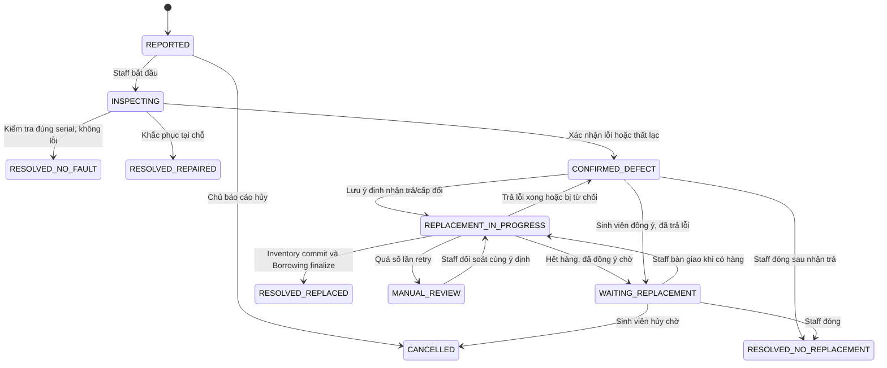
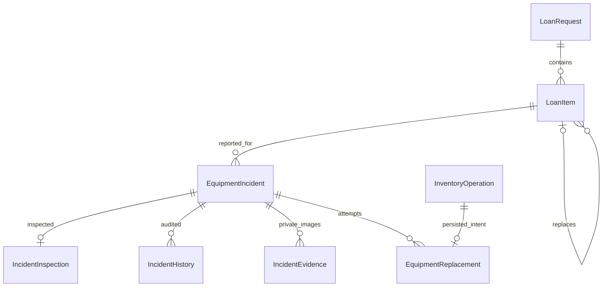

# Equipment Incident & Replacement — Flow 3

Ngày triển khai: 18/11/2026. Không thêm microservice, dịch vụ trả phí hoặc cơ chế mượn/kho cạnh tranh.

## Phạm vi và quyết định kiến trúc

1. Borrowing sở hữu báo cáo, kết luận kiểm tra, lịch sử, bằng chứng, ý định xử lý và quan hệ mục mượn cũ/mới.
2. Inventory sở hữu tài sản vật lý, reservation, stock movement, maintenance và biên nhận cấp đổi bất biến.
3. Chỉ nhân viên/quản trị viên xác nhận kết quả kiểm tra. Ảnh không thay thế việc nhận thiết bị và đối chiếu serial. Nhóm vấn đề do sinh viên chọn không phải chẩn đoán hoặc kết luận trách nhiệm.
4. Đổi ngay: cùng loại, LoanId và DueAt không đổi; mục gốc DAMAGED có ReturnedAt, mục mới có Id riêng, IncidentId và ReplacesLoanItemId. Không ghi đè AssetUnitId gốc.
5. Hết hàng: trả 409 OUT_OF_STOCK; transaction Inventory rollback hoàn toàn. Nhân viên có thể nhận trả máy lỗi qua cơ chế DAMAGED. Sinh viên phải tự chọn chờ; có thể hủy chờ. Nhân viên có thể đóng sau khi nhận trả nếu không còn nhu cầu.
6. Cấp sau khi trả: yêu cầu có đồng ý chờ và hạn trả gốc còn hiệu lực. Nếu phiếu gốc còn BORROWED, thêm mục mới trên phiếu đó. Nếu phiếu gốc RETURNED, tạo phiếu tiếp nối riêng, có lịch sử và liên kết với mục gốc; không mở lại phiếu terminal. Phiếu tiếp nối đang chờ giao được lưu APPROVING và chỉ chuyển BORROWED sau xác nhận Inventory. Cấp thất bại sẽ để lại APPROVAL_FAILED có kiểm toán.

## Trạng thái và chuyển tiếp

LOST được kiểm tra bằng ghi chú xác minh, không được ghi là đã nhận máy thực tế. Khi luồng LOST return hoàn tất, sự cố được đóng không cấp đổi. Không cấp máy khác cho kết luận LOST.

## ERD và ownership

Các bảng trên thuộc borrowing_db. `ReplacementOperations` thuộc inventory_db, lưu OperationId, SHA-256 request hash, JSON kết quả bất biến và thời điểm. AssetUnitId, EquipmentTypeId, Actor/StudentId giữa các service chỉ là logical reference; không có FK xuyên database. Migration chỉ thêm bảng, sequence, cột nullable và index/FK nội bộ; không sửa migration cũ.

`IncidentNumber` là PostgreSQL sequence. Code `INC-yyyy-000001` dùng giá trị sequence, không MAX+1; khoảng trống do rollback là bình thường. Unique index chặn trùng Code, (StudentId, SubmissionKey), nhiều sự cố mở trên cùng LoanItem và nhiều lần cấp đổi thành công cho cùng sự cố. `xmin` bảo vệ cập nhật aggregate. Mục mới tham chiếu FK đến sự cố và LoanItem gốc.

## Transaction và phục hồi

- API và worker dùng cùng `LoanLock` của phiếu gốc. Ý định `INC_REPLACE` hoặc `INC_RETURN` cùng actor, correlation và RequestJson được commit **trước** RPC. Unique index InventoryOperations chỉ cho một thao tác chưa kết thúc trên mỗi loan.
- RPC cấp đổi serialize theo operation ID bằng advisory transaction lock. Retry cùng ID khác payload trả OPERATION_ID_REUSED. Retry cùng payload trả nguyên biên nhận đã lưu, kể cả khi tài sản đã bảo trì/trả sau đó. Kết luận từ chối dứt khoát (hết hàng, quá hạn, allocation gốc không hợp lệ) cũng được lưu thành receipt, không đổi thành một allocation mới sau khi có hàng trở lại. Receipt từ chối không có thay đổi kho.
- Inventory khóa reservation và máy gốc; kiểm tra loan/item/asset/type, HANDED_OVER (hoặc RETURNED DAMAGED cho cấp chờ); chọn máy AVAILABLE khác bằng UPDATE có `FOR UPDATE SKIP LOCKED`. Cùng transaction: trả máy lỗi, maintenance, movement, reservation mới, bàn giao máy mới, lưu receipt. Không lấy reservation của người khác.
- DueAt nằm trong request hash và RPC. Inventory từ chối allocation mới đã quá hạn, nhưng vẫn trả receipt thành công trước đó. Borrowing có thể hoàn tất đối soát sau hạn mà không phát sinh cấp đổi mới hoặc đổi hạn.
- Borrowing hỏi `GetReplacementOperationStatus` trước. Nếu chưa có receipt, gọi lại đúng ID/payload; không tạo mutation khác để đoán kết quả. Finalize LoanItem cũ/mới, incident, lịch sử, operation và outbox trong một transaction Borrowing.
- Mất phản hồi hoặc lỗi commit local để lại PENDING/RETRY. Job reconciliation hiện có phục hồi; hết MaxAttempts chuyển MANUAL_REVIEW. Màn hình hiển thị chưa hoàn tất và cho Staff đối soát lại đúng ý định. Không có success event trước khi finalize.
- Nhận trả thông thường chặn mục có sự cố mở, buộc xử lý từ màn hình sự cố. Nhận trả sau cấp đổi đọc mọi allocation của loan, kể cả reservation do cấp đổi tạo ra.
- Không có transaction phân tán hoặc truy cập database của service khác.

## Thông báo thật

Outbox Borrowing → Redis Streams → consumer Notification → inbox dedup + Notification DB. Envelope version 1 dùng event ID ổn định theo history/action/recipient. `IncidentReported` gửi nhân viên đã bàn giao (fallback người duyệt); hàng đợi sự cố vẫn cho mọi Staff/Admin đọc. Các sự kiện bắt đầu kiểm tra, kết quả, cấp đổi và đóng gửi chủ sự cố. Một lần cấp đổi thành công chỉ phát một EquipmentReplaced. Các sự kiện loan cũ giữ nguyên contract.

Gateway giữ mức 120 request/phút nhưng phân bucket theo `sub` đã xác thực cho người dùng đăng nhập, theo IP cho khách. Các vai trò dùng chung mạng lab/nginx không còn dùng chung một quota. Không dựa vào header tự khai và không tắt rate limit cho test.

## Ảnh riêng tư

Tối đa 3 ảnh, 5 MB/ảnh, JPEG/PNG/WebP, tối đa 4096 × 4096. Kiểm tra cấu trúc raster thực, kích thước và giới hạn; PNG kiểm checksum chunk và giải nén có giới hạn (8-bit không xen kẽ). Không nhận SVG/HTML; không tin filename hay MIME. Nội dung `bytea` thuộc Borrowing DB, hash chống upload lặp. Không có public storage URL, đường dẫn người dùng hoặc endpoint upload ẩn danh.

Xem ảnh phải qua JWT và quyền owner/Staff/Admin; 404 với tài nguyên người khác, `private, no-store`, `nosniff`, CSP sandbox. Frontend dùng client JWT/refresh chung và object URL tạm, không đưa token vào URL/storage. Lưu báo cáo trước, ảnh thất bại có thể gửi lại khi chưa bắt đầu kiểm tra. Dữ liệu tồn tại nhờ volume PostgreSQL hiện có; backup phải bao gồm bằng chứng. Nhiều API instance dùng chung DB được; ảnh làm tăng dung lượng backup/database, chưa có object-storage adapter, xử lý EXIF hay antivirus chuyên dụng.

## Migration và chạy local

Xem [demo](../demo/INCIDENT_REPLACEMENT_DEMO.md) cho setup và PowerShell. Inventory dùng migration `20261118023420_AddReplacementReceipts`; Borrowing dùng `20261118023405_AddEquipmentIncidents`. Startup migration của dự án tự áp dụng khi cấu hình hiện có cho phép. Không cần migration Notification hay database mới.

## Kiểm chứng và giới hạn

Kết quả cuối được ghi tại [INCIDENT_TEST_EVIDENCE](../testing/INCIDENT_TEST_EVIDENCE.md). Test transaction dùng PostgreSQL thật, API Kestrel và gRPC được xác thực; fault injection chỉ làm rơi phản hồi của thao tác thật hoặc gây lỗi transaction Borrowing thật. Browser sử dụng API/worker/Redis thật, không mock business response.

Giới hạn chủ ý: chỉ cấp cùng loại; không có AI hoặc tự thay loại tương đương; không đổi hạn gốc; không tự phân bổ máy hay gửi thông báo có hàng trở lại khi chờ. Nhân viên xem tồn kho thật và bàn giao trực tiếp. Không suy luận trách nhiệm hoặc tiền bồi thường. Bộ chọn thiết bị/nhân viên tìm theo tên hoặc email qua API, tải một trang kết quả có giới hạn để không tải toàn bộ danh bạ lên trình duyệt.
